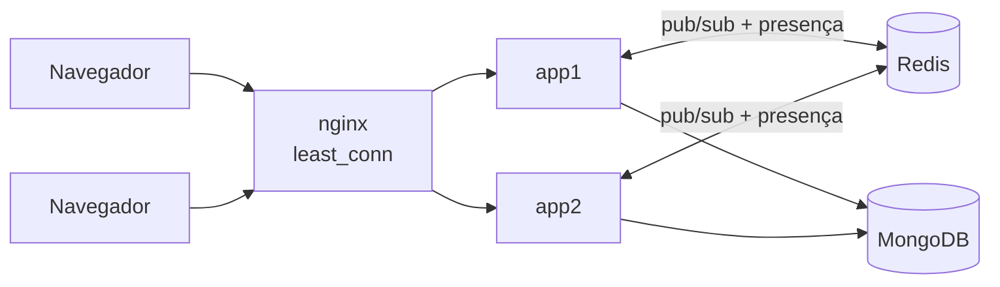

# WebFlux Chat

Chat em tempo real com salas, histórico, presença e "digitando…", feito com **Spring WebFlux** (Reactor), **MongoDB** reativo e **Redis Pub/Sub** para rodar em várias instâncias ao mesmo tempo.

O objetivo do projeto é mostrar programação reativa aplicada a um problema em que ela faz diferença: milhares de conexões abertas por muito tempo (SSE), sem uma thread bloqueada por cliente.

## Funcionalidades

- Salas (criadas ao entrar) e histórico: quem entra recebe as últimas 50 mensagens, em ordem, e depois continua ao vivo.
- Cadastro e login com **JWT**; o autor de cada mensagem é o dono do token, nunca um campo do corpo.
- **Presença**: lista de quem está online e avisos de entrada e saída. Várias abas do mesmo usuário contam como uma presença só.
- **"Digitando…"** como evento efêmero (não é gravado).
- **Várias instâncias** atrás de um balanceador: uma mensagem enviada em uma instância chega aos clientes conectados em outra.
- Backpressure por cliente: um cliente lento não segura o servidor nem os outros clientes.

## Arquitetura



Caminho de uma mensagem:

1. `POST /rooms/{sala}/messages` chega a qualquer instância, com o JWT no header.
2. O serviço **grava no Mongo primeiro**. Só depois publica o evento no barramento (`ChatBus`).
3. O barramento entrega o evento a **todas** as instâncias que têm clientes naquela sala (Redis: canal `chat:{sala}`).
4. Cada instância repassa o evento ao seu sink local da sala, que faz o fan-out para as conexões SSE, cada uma com um buffer próprio.

O `ChatBus` tem duas implementações: `LocalChatBus` (memória, uma instância, é o padrão) e `RedisChatBus` (perfil `redis`). O resto do código não sabe qual está em uso.

## Como rodar

### Stack completa (Docker)

```
docker compose up --build
```

Sobe MongoDB, Redis, **duas instâncias** da aplicação e um nginx na frente. Abra <http://localhost:8080> em duas abas, crie duas contas e converse. O header `X-Instance` das respostas mostra qual instância atendeu cada requisição.

Variáveis opcionais (valores padrão são só para desenvolvimento):

| Variável | Padrão | Uso |
|---|---|---|
| `CHAT_PORT` | `8080` | porta do nginx no host |
| `MONGO_PORT` / `REDIS_PORT` | `27017` / `6379` | portas publicadas no host |
| `MONGO_PASSWORD` | `example` | senha do usuário root do Mongo |
| `JWT_SECRET` | valor de desenvolvimento | segredo HS256, **mínimo 32 bytes**; defina em qualquer ambiente real |

Se você já tinha um volume do Mongo criado sem usuário, rode `docker compose down -v` uma vez (apaga os dados).

### Desenvolvimento (aplicação pela IDE ou Maven)

```
docker compose up -d mongo redis
./mvnw spring-boot:run
```

Sem perfil, a aplicação usa o barramento local e **não toca no Redis**. Para exercitar o modo multi-instância na sua máquina, suba duas portas com o perfil `redis`:

```
./mvnw spring-boot:run -Dspring-boot.run.arguments="--server.port=8081 --spring.profiles.active=redis"
./mvnw spring-boot:run -Dspring-boot.run.arguments="--server.port=8082 --spring.profiles.active=redis"
```

Requisitos: Java 21 e Docker.

## Usando a API

```
# cadastro e login (o token vem em {"token": "..."})
curl -X POST localhost:8080/auth/register -H 'Content-Type: application/json' -d '{"username":"ana","password":"secret1"}'
TOKEN=$(curl -s -X POST localhost:8080/auth/login -H 'Content-Type: application/json' \
  -d '{"username":"ana","password":"secret1"}' | python3 -c 'import sys,json;print(json.load(sys.stdin)["token"])')

# escuta a sala (fica aberto)
curl -N -H "Authorization: Bearer $TOKEN" localhost:8080/rooms/geral/stream

# em outro terminal: envia mensagem e avisa que está digitando
curl -X POST localhost:8080/rooms/geral/messages -H "Authorization: Bearer $TOKEN" \
  -H 'Content-Type: application/json' -d '{"text":"oi"}'
curl -X POST localhost:8080/rooms/geral/typing -H "Authorization: Bearer $TOKEN"
```

| Rota | Descrição | Respostas |
|---|---|---|
| `POST /auth/register` | `{username (3-30), password (6-72)}` | 201, 400, 409 (usuário já existe) |
| `POST /auth/login` | mesmo corpo; devolve `{token}` | 200, 401 (mesma resposta para usuário inexistente e senha errada) |
| `GET /rooms/{sala}/stream` | SSE da sala | 200, 401 |
| `POST /rooms/{sala}/messages` | `{text (1-1000)}` | 200 com a mensagem gravada, 400, 401 |
| `POST /rooms/{sala}/typing` | avisa que está digitando | 204, 401 |
| `GET /actuator/health` | saúde da aplicação | 200 |

Eventos do stream (o nome vai no campo `event:` do SSE):

| Evento | Quando | Dados |
|---|---|---|
| `message` | histórico (últimas 50) e mensagens novas | `{id, room, user, text, createdAt}` |
| `presence` | uma vez, logo após o histórico | `{"users": ["ana","bia"]}` |
| `joined` / `left` | primeira conexão / última conexão de um usuário | `{"user": "bia"}` |
| `typing` | alguém está digitando | `{"user": "bia"}` |

## Decisões de projeto

- **SSE em vez de WebSocket.** O tráfego é assimétrico (muitos eventos para o cliente, poucos envios), e enviar já é um POST comum. SSE é HTTP puro, passa por proxies e reconecta sozinho.
- **`fetch` em vez de `EventSource` no front.** O `EventSource` do navegador não consegue enviar o header `Authorization`, e colocar o token na URL o deixaria em logs de proxy. O front lê o stream com `fetch` + `ReadableStream` e interpreta o formato SSE.
- **Sink por sala com `directBestEffort`.** O `multicast().onBackpressureBuffer()` encerra o sink quando o último assinante sai, e quem entrasse depois receberia o fim do fluxo na hora. O `directBestEffort` sobrevive e não acumula eventos sem ouvintes (o histórico vem do banco).
- **Buffer de 100 eventos por cliente, descartando os mais antigos** (`onBackpressureBuffer` com `DROP_OLDEST`). Quem não acompanha perde eventos velhos em vez de travar o servidor.
- **Gravar antes de publicar.** O stream nunca mostra algo que não está no banco, e o que sai ao vivo é o mesmo objeto que entra no histórico. Se a publicação falhar, a mensagem continua gravada e só a entrega ao vivo se perde (fica no log).
- **Ciclo de vida das salas.** Uma sala existe em memória enquanto houver conexão nela; a última conexão remove a sala e cancela a inscrição no Redis, o que evita vazamento de memória.
- **Presença global.** No Redis, um hash por sala (`presence:{sala}`) conta as conexões de cada usuário em todas as instâncias; a saída é um script Lua (decrementa e remove em uma operação atômica). Assim o `joined` e o `left` saem uma vez só, mesmo com o usuário em duas abas e duas instâncias.
- **BCrypt fora do event loop.** É intencionalmente lento, então roda em `Schedulers.boundedElastic()`.
- **JWT pelo suporte nativo do Spring Security** (`oauth2-resource-server` com chave HMAC), sem filtro próprio. CSRF fica desligado porque a autenticação é por header `Authorization`, não por cookie.
- **nginx com `least_conn` e `proxy_buffering off`.** Os streams duram horas, então a nova conexão vai para quem tem menos abertas; sem desligar o buffer, o nginx seguraria os eventos.

## Testes

```
./mvnw verify
```

Precisa de Docker: os testes de integração sobem Mongo e Redis descartáveis com Testcontainers, sem tocar nos seus dados.

- **Serviço** (`StepVerifier`): entrega por sala, ordem do histórico, presença na primeira e na última aba, "digitando" que não é gravado, sala removida ao esvaziar, backpressure (cliente lento fica só com os 100 eventos mais novos) e duas instâncias compartilhando o barramento.
- **Repositório** com Mongo real: ordem, limite de 50, isolamento entre salas, `username` único.
- **Fluxo completo por HTTP** com Mongo real: cadastro, login, histórico + presença + ao vivo, autor vindo do token, queda de conexão gerando `left`.
- **`RedisChatBus` com Redis real**: troca de eventos entre instâncias, ida e volta do JSON, payload inválido descartado sem derrubar o feed, contagem de presença entre instâncias.
- **Segurança**: sem token, token expirado, assinado com outra chave, sem assinatura e com payload adulterado (cada caso rejeitado tem um controle válido).

## Limitações conhecidas

- **Eventos perdidos na entrada.** Um evento publicado entre o fim do histórico e a assinatura do fluxo ao vivo não chega àquele cliente (a mensagem fica no banco). No Redis há também uma janela entre pedir o `SUBSCRIBE` e ele ser confirmado. A correção é enviar o `id` em cada evento SSE e usar o cabeçalho `Last-Event-ID` ao reconectar.
- **Presença presa se uma instância cair.** Os contadores ficam no Redis; se uma instância morrer sem encerrar as conexões, o usuário pode continuar "online". A correção é uma chave por instância com TTL e heartbeat.
- **O front não reconecta sozinho** (o `EventSource` faria isso, mas foi trocado por `fetch`); recarregue a página.
- **"Digitando" sem limite de frequência no servidor.** O front envia no máximo um a cada 2 s, mas quem chamar a API direto pode enviar mais.
- **Sem refresh token nem logout no servidor.** O token vale 12 horas (`app.jwt.ttl`) e fica no `sessionStorage` do navegador.
- **Credenciais do compose são de desenvolvimento** (senha `example`, segredo JWT padrão). Defina `MONGO_PASSWORD` e `JWT_SECRET` fora do ambiente local.

## Estrutura

```
src/main/java/dev/joao/chat/
├── auth/   AuthController, SecurityConfig, User, UserRepository
└── chat/   ChatController, ChatService, ChatBus (LocalChatBus, RedisChatBus), ChatEvent, Message, MessageRepository
src/main/resources/static/index.html   front em JS puro
docker/nginx.conf                      balanceador
Dockerfile, docker-compose.yml
```

## Stack

Java 21, Spring Boot 4.1 (WebFlux, Security com OAuth2 Resource Server, Data MongoDB Reactive, Data Redis Reactive), Reactor, MongoDB 9, Redis 7, nginx, Docker Compose, JUnit 5, Testcontainers.
